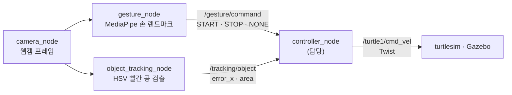

<div align="center">

# 제스처로 제어하는 물체 추적 로봇

**손 제스처(보자기 → 추적 시작, 주먹 → 정지)로, 카메라가 찾은 빨간 공을 시뮬레이션 로봇이 따라가게 하는 ROS 2 스터디 팀 프로젝트입니다.**


</div>

<br>

## 🧭 개요

| 항목 | 내용 |
|---|---|
| 구분 | ROKEY 9기 스터디 팀 프로젝트 |
| 기간 | 2026.07.10 ~ 2026.08.05 |
| 인원 · 담당 | 5인 팀 · 담당: 상태 · 이동 제어 (`controller_node` · 제어 알고리즘 · 추적 상태 머신) |
| 환경 | ROS 2 Jazzy · Python 3.12 · OpenCV · MediaPipe · turtlesim · Gazebo(TurtleBot3) · pytest |
| 상태 | ✅ 팀 통합 테스트 · 시연(8/4 촬영) — 시연 영상은 이 저장소에 없습니다 |
| 원본 | 팀 저장소 [Jik-Kim/study-project](https://github.com/Jik-Kim/study-project) |

## 🎯 배경과 목표

GitHub로 협업하는 방식을 익히는 스터디에서, 카메라 하나로 **손 제스처와 물체를 함께 인식해 로봇을 움직이는** 작은 시스템을 만들었습니다.

1. 보자기를 보이면 추적을 시작하고, 주먹을 쥐면 멈춥니다.
2. 카메라가 HSV 색상으로 빨간 공을 찾으면, 화면 중심 대비 위치 오차와 검출 면적을 속도 명령으로 바꿉니다.
3. turtlesim(2D)과 Gazebo(3D, TurtleBot3)에서 로봇이 공을 따라갑니다.

## 🏗 구성



| 노드 | 역할 |
|---|---|
| `camera_node` | 웹캠 프레임 캡처 → `/camera/image_raw` 발행 |
| `gesture_node` | MediaPipe 손 랜드마크 → `START` / `STOP` / `NONE` 명령 |
| `object_tracking_node` | HSV 필터로 빨간 공 검출 → 위치 오차(`error_x/y`) · 면적(`area`) 계산 |
| **`controller_node`** | **제스처 · 추적 오차 → `geometry_msgs/Twist` 속도 명령 (담당)** |
| `main_ui` | Tkinter 4분할 시각화(영상 · 상태 · 토픽 흐름 · 속도 그래프) |

## 🙋 내가 한 것

제스처와 추적 오차를 받아 로봇 속도 명령을 만드는 **상태 · 이동 제어 파트**를 맡아, `controller_node` · `tracking_controller.py` · `tracking_state.py`를 설계 · 구현했습니다.

1. **제어 인터페이스 약속** — 팀 회의에서 제어 노드가 받을 데이터 규약을 제안해 확정하고 팀 문서(`docs/SOT.md` · `docs/interfaces.md`)에 반영했습니다.
   - 오차 부호: `error_x = 공 중심 x − 화면 중심 x`(오른쪽 +, 왼쪽 −)
   - 거리는 검출 면적(`area`)으로 근사하고, `error_y`는 이번 범위에서 쓰지 않음(필드만 유지)
   - QoS: 제어 명령 `RELIABLE`, 추적 결과 `BEST_EFFORT`(KEEP_LAST, depth 1)
   - STOP · 미검출 · 메시지 끊김 때 정지하는 규칙
2. **제어 알고리즘** (`core/tracking_controller.py`)
   - 회전 `angular_z = −angular_gain × error_x`, 전진 `linear_x = linear_gain × (target_area − area)` — 비례 제어 · 중앙/목표 면적 deadband · 최대 속도 제한
   - 공이 너무 크게 잡히면 후진하지 않고 정지
   - 계산 결과를 `VelocityCommand` 값 객체로 돌려줘 제어 로직과 ROS 계층을 나눔
3. **추적 상태 머신** (`core/tracking_state.py`) — 초기 상태 `STOP`, 제스처로 `START` / `STOP` 전이, `NONE`은 이전 상태 유지
4. **제어 ROS 2 노드** (`nodes/controller_node.py`)
   - 이동 제어 파라미터 8종을 선언해 실행 중 튜닝 가능
   - `/gesture/command`(RELIABLE) · `/tracking/object`(BEST_EFFORT) 구독 → `/turtle1/cmd_vel` 발행
   - **안전 정지 3가지:** STOP 제스처 즉시 정지 · `detected=false` 즉시 정지 · 10 Hz 타이머로 추적 신호가 끊기면 정지. 다시 검출되고 상태가 `START`면 자동으로 이어 감
5. **시험 · 튜닝** — `TrackingController` 단위 시험(목표 면적에서 정지 · 과대 검출 때 후진 안 함 · STOP · 미검출 때 0 속도)을 쓰고, 통합 테스트 뒤 게인 초깃값을 `0.004`로 보정했습니다.

그 외로 `sim_bringup` 패키지를 처음 만들고 turtlesim / Gazebo bringup launch를 처음 작성했습니다(이후 4분할 UI · Gazebo 확장은 통합 담당 팀원이 발전시킴). 관련 PR: [#2](https://github.com/Jik-Kim/study-project/pull/2) · [#14](https://github.com/Jik-Kim/study-project/pull/14) · [#18](https://github.com/Jik-Kim/study-project/pull/18)

## 📊 결과

- 팀 통합 테스트에서 게인을 보정한 뒤, 제스처로 추적을 시작 · 정지하며 turtlesim · Gazebo 로봇이 공을 따라가는 시연을 했습니다(8/4 촬영).
- 단위 시험 7개 통과 — 제어기(`test_tracking_controller.py`) 3개 · 색 검출(`test_color_tracker.py`) 4개.

## 💡 배운 점

- **토픽별 QoS 분리** — 제스처 명령은 유실되면 안 되어 `RELIABLE`, 추적 결과는 최신값이 중요해 `BEST_EFFORT`로 나눴습니다. 한 노드 안에서도 토픽 성격에 따라 QoS를 달리해야 한다는 것을 배웠습니다.
- **"신호 없음" 감지** — 구독 콜백만으로는 추적 메시지가 끊긴 상황을 알 수 없어, 마지막 수신 시각을 검사하는 10 Hz 타이머로 타임아웃 정지를 넣었습니다.
- **비례 제어 게인** — 게인이 크면 목표 면적 부근에서 진동하고 작으면 반응이 느려, deadband와 함께 통합 테스트로 맞췄습니다(`0.004`).
- **의존성 충돌(팀 공통)** — MediaPipe 설치가 `numpy`를 2.x로 올려 ROS 2 Jazzy의 `cv_bridge`와 충돌(`KeyError: 16`)했습니다. `numpy==1.26.4` + `mediapipe==0.10.14`로 고정해 해결하고 팀 문서에 남겼습니다.

## ⚠️ 한계

- 실제 로봇이 아니라 turtlesim · Gazebo 시뮬레이션에서만 동작합니다.
- 거리는 검출 면적으로 근사하고 `error_y`는 쓰지 않았습니다. 색은 HSV로 빨간 공 하나만 찾아 조명에 민감합니다.
- 8/4 시연 영상은 이 저장소에 없습니다.

## 📂 폴더 구조

```text
gesture-controlled-robot-tracking/
├── README.md
├── src/                              ROS 2 패키지 3개 (이 폴더가 colcon 워크스페이스)
│   ├── gesture_robot/                노드 · 핵심 로직(core/) · 어댑터 · UI · 시험(test/)
│   ├── gesture_robot_interfaces/     메시지 2개 — GestureCommand · TrackedObject
│   └── sim_bringup/                  turtlesim · Gazebo bringup launch · TurtleBot3 모델
├── docs/                             팀 문서 — 기준(SOT) · 구조 · 인터페이스 · 환경 설정
└── LICENSE                           MIT (원본 팀 저장소 라이선스)
```

`docs/`는 팀 저장소 문서를 그대로 옮긴 것입니다. 문서 속 `ros2_ws/`는 이 폴더 자체를 가리킵니다.

## 🚀 실행 방법

```bash
# 1. Python 의존성 (ROS 2 Jazzy 와 맞는 조합 — 버전 고정 필수)
pip install --break-system-packages "numpy==1.26.4" "mediapipe==0.10.14"

# 2. 빌드 · 환경 로드 (이 폴더에서)
cd gesture-controlled-robot-tracking
source /opt/ros/jazzy/setup.bash
colcon build --symlink-install
source install/setup.bash

# 3-a. turtlesim 2D 통합 실행
ros2 launch sim_bringup turtlesim_bringup.launch.py

# 3-b. Gazebo 3D (TurtleBot3) 실행
ros2 launch sim_bringup gazebo_bringup.launch.py
```

웹캠이 필요합니다. 단위 시험만 돌리려면 `cd src/gesture_robot && python3 -m pytest -q test`.

## 📜 출처와 라이선스

- 5인 스터디 팀의 원본 저장소 [Jik-Kim/study-project](https://github.com/Jik-Kim/study-project)의 코드와 문서를 옮겨 담았습니다. 커밋 기록과 PR은 원본 저장소에 있습니다.
- 이 폴더는 원본 라이선스인 [MIT License](LICENSE)를 따릅니다(저장소의 다른 폴더는 Apache-2.0).
- 사용한 라이브러리: MediaPipe · OpenCV(각 Apache-2.0), ROS 2 Jazzy · turtlesim · Gazebo.
