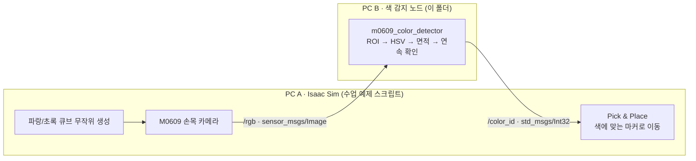

<div align="center">

# Isaac Sim M0609 색상 분류: ROS 2 색 감지 노드

**Isaac Sim 속 M0609가 큐브를 같은 색 마커로 옮기도록, 팀원이 만든 색 감지 노드를 파랑·초록 시나리오에 맞게 수정하고 Isaac Sim과 연동했습니다.**


</div>

<br>

## 🧭 개요

| 항목 | 내용 |
|---|---|
| 구분 | ROKEY 9기 협동-3 사전 실습 |
| 기간 | 2026-08-19 ~ 08-20 |
| 인원 · 담당 | 4인 (GPU PC 2대에 2명씩) · 담당: 반대편 PC 팀원이 만든 색 감지 노드를 우리 시나리오에 맞게 수정하고 Isaac Sim과 연동 |
| 환경 | NVIDIA Isaac Sim · ROS 2 Jazzy · OpenCV (HSV) · NumPy · GPU PC 2대 |
| 상태 | ✅ 로봇팔이 큐브를 색에 맞는 마커 위에 놓는 전체 동작 확인 · 실행 영상 없음 |

## 🎯 배경과 목표

Isaac Sim에서 무작위 위치에 생기는 파랑·초록 큐브를 두산 M0609가 손목 카메라로 보고, 같은 색 마커 위에 옮겨 놓는 실습입니다.
큐브 생성과 로봇팔 동작은 수업에서 받은 예제 스크립트가 맡고, 로봇팔이 보내는 카메라 영상에서 큐브 색을 판별하는 **ROS 2 색 감지 노드**가 필요했습니다.

4명이 GPU PC 2대에 2명씩 나눠 색 감지 노드를 각자 만들고, 잘 되는 쪽으로 완성하기로 했습니다.
반대편 PC에서 만든 노드를 골라, **제가 우리 시나리오에 맞게 수정하고 Isaac Sim과 연동하는 일을 맡았습니다.**

## 🏗 구성

시뮬레이션 쪽(PC A)과 색 감지 쪽(PC B)을 ROS 2 토픽 두 개로만 연결하는 구조입니다.



| 토픽 | 타입 | 의미 |
|---|---|---|
| `/rgb` | `sensor_msgs/msg/Image` | 손목 카메라 영상 (PC A → PC B) |
| `/color_id` | `std_msgs/msg/Int32` | 0 = 판단 불가, 1 = 파랑, 2 = 초록 (PC B → PC A) |

### 색 감지 노드의 처리 흐름 (반대편 PC 팀원 구현)

- **화면 중앙만 판단**: 영상 가장자리 20%(`roi_margin`)를 잘라 그리퍼나 배경이 색 판단에 끼지 않게 합니다.
- **HSV 마스크와 잡음 제거**: 열기·닫기 연산으로 잡음을 지운 뒤, 가장 큰 영역의 면적이 `min_area`(500px) 이상일 때만 색으로 인정합니다.
- **연속 확인 후 확정**: 같은 결과가 `stable_frames`(3프레임) 연속 나와야 결과를 바꿉니다.
- **주기적 재발행**: 확정된 결과를 0.2초마다(5Hz) 다시 보내, 시뮬레이션 쪽이 늦게 켜지거나 통신이 잠깐 끊겨도 다시 받을 수 있게 합니다.
- 카메라 토픽은 sensor data QoS(best effort)로 구독하고, 토픽 이름·ROI·최소 면적·디버그 창을 ROS 파라미터로 바꿀 수 있습니다.

## 🙋 내가 한 것

가져온 노드를 우리 시나리오에 맞게 고치고 Isaac Sim과 연결했습니다 → [`src/m0609_color_detector.py`](src/m0609_color_detector.py)

- **판별 색을 빨강 → 파랑으로 변경**: 가져온 노드는 빨강·초록을 구분하도록 되어 있었습니다. 우리 시나리오(파랑 = 1, 초록 = 2)에 맞춰, 빨강용 HSV 두 구간(색상환 양 끝)을 파랑 한 구간(H 100~130)으로 바꾸고 판정·로그·디버그 표시를 모두 파랑 기준으로 고쳤습니다.
- **cv_bridge 없이 영상 해석**: 이 PC에서는 `cv_bridge`가 NumPy 2.x와 충돌해, 실제 영상이 들어오는 순간 노드가 세그폴트로 죽었습니다. `cv_bridge`를 빼고 `Image` 메시지 버퍼를 NumPy로 직접 읽도록 바꿨습니다(`rgb8`·`bgr8`·`mono8`, 길이가 모자란 프레임은 경고 후 건너뜀).
- **토픽 확인**: 강의 토픽 구조도와 대조해 결과 토픽 `/color_id`(Int32)는 그대로 두었습니다.
- **시험과 연동**: 녹화해 둔 카메라 rosbag을 재생해 파랑·초록이 맞게 나오는지 먼저 확인한 뒤, Isaac Sim 쪽과 연결했습니다.

## 📊 결과

- 녹화해 둔 카메라 rosbag을 재생해 노드를 먼저 시험한 뒤, Isaac Sim과 연결했습니다.
- 로봇팔이 큐브 색에 맞는 마커 위에 놓는 전체 동작을 끝까지 확인했습니다.
- 실행 영상은 남기지 않았습니다.

## 💡 배운 점

- **인터페이스부터 정하기**: PC 두 대가 같은 `ROS_DOMAIN_ID`에서 **토픽 이름·메시지 타입·값의 의미**만 맞추면 역할을 깔끔하게 나눌 수 있었습니다. 코드를 쓰기 전에 인터페이스부터 정하는 게 중요했습니다.
- **결과 안정화**: 시뮬레이션 영상이라도 한 프레임 결과를 바로 믿으면 흔들립니다. 가져온 노드의 관심 영역·최소 면적·연속 프레임 확인 구조를 보며, 결과를 안정시키는 방법을 배웠습니다.
- **라이브러리 호환성**: `cv_bridge`와 NumPy 2.x 문제처럼 코드가 아니라 라이브러리 호환성 때문에 생기는 오류도 있었습니다. 이런 경우 버전을 맞추거나, 문제가 되는 의존성을 빼는 방법으로 피할 수 있었습니다.
- **주기적 재발행**: 받는 쪽이 언제 준비될지 모르는 분산 구조에서는, 결과를 한 번만 보내기보다 주기적으로 다시 보내는 편이 안전했습니다.

## ⚠️ 한계

- 실행 영상이 없습니다.
- HSV 범위는 Isaac Sim 큐브 재질과 조명 기준입니다. 실제 카메라와 조명에서는 다시 맞춰야 합니다.
- 파랑·초록 두 색만 구분합니다.
- 큐브 생성과 로봇팔 동작을 맡은 Isaac Sim 쪽 스크립트는 수업에서 받은 예제라 이 저장소에 넣지 않았습니다.
- 노드의 기본 구조는 반대편 PC 팀원이 만든 것이고, 제 몫은 위 '내가 한 것'의 수정과 연동입니다.

## 📂 폴더 구조

```text
isaac-m0609-color-sort/
├── README.md
└── src/
    └── m0609_color_detector.py   # ROS 2 색 감지 노드 (/rgb 구독 → /color_id 발행)
```

## 🚀 실행 방법

```bash
# 저장소 루트에서
cd isaac-m0609-color-sort
source /opt/ros/jazzy/setup.bash
pip install opencv-python numpy
# 시뮬레이션 쪽과 같은 ROS_DOMAIN_ID를 사용
python3 src/m0609_color_detector.py --ros-args -p debug_view:=true
```

| 파라미터 | 기본값 | 의미 |
|---|---|---|
| `image_topic` | `/rgb` | 구독할 카메라 영상 토픽 |
| `color_topic` | `/color_id` | 결과를 보낼 토픽 |
| `roi_margin` | `0.20` | 상하좌우에서 잘라낼 가장자리 비율 |
| `min_area` | `500.0` | 색으로 인정할 최소 면적(px) |
| `stable_frames` | `3` | 결과를 바꾸기 전 연속으로 같아야 하는 프레임 수 |
| `debug_view` | `false` | `true`면 ROI 영상과 선택된 마스크를 OpenCV 창으로 표시 |

## 📜 출처와 라이선스

- 코드는 저장소 루트 [LICENSE](../LICENSE)(Apache-2.0)를 따릅니다.
- 노드의 기본 구조(관심 영역·HSV 마스크·연속 확인·주기적 재발행)는 반대편 PC 팀원이 만든 것이고, 이 파일은 그 노드를 우리 시나리오에 맞게 수정한 버전입니다.
- 큐브 생성과 로봇팔 동작을 맡은 Isaac Sim 쪽 스크립트는 수업 예제라 포함하지 않았습니다.
- 실행에 쓰는 ROS 2·OpenCV·NumPy·NVIDIA Isaac Sim은 저장소에 포함하지 않으며, 각자의 라이선스를 따릅니다.
