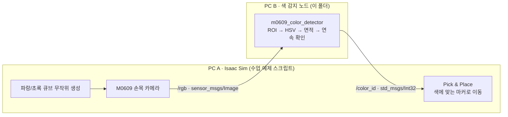

# Isaac Sim M0609 색상 분류: ROS 2 색 감지 노드

Isaac Sim에서 무작위 위치에 생기는 파랑·초록 큐브를 두산 M0609가 손목 카메라로 보고, 같은 색 마커 위에 옮겨 놓는 실습입니다.
로봇팔이 보내는 카메라 영상을 받아 큐브 색을 판별해 돌려주는 **ROS 2 색 감지 노드**를 만들었습니다.

`ROKEY 9기 협동-3 사전 실습` · `2026-08-19 ~ 08-20` · `NVIDIA Isaac Sim` · `ROS 2 Jazzy` · `OpenCV (HSV)`

## 구성

시뮬레이션 쪽(PC A)과 색 감지 쪽(PC B)을 ROS 2 토픽 두 개로만 연결하는 구조입니다.



| 토픽 | 타입 | 의미 |
|---|---|---|
| `/rgb` | `sensor_msgs/msg/Image` | 손목 카메라 영상 (PC A → PC B) |
| `/color_id` | `std_msgs/msg/Int32` | 0 = 판단 불가, 1 = 파랑, 2 = 초록 (PC B → PC A) |

## 내가 한 것: 색 감지 노드 [`src/m0609_color_detector.py`](src/m0609_color_detector.py)

- **화면 중앙만 판단**: 영상 가장자리 20%(`roi_margin`)를 잘라 그리퍼나 배경이 색 판단에 끼지 않게 했습니다.
- **HSV 색 범위와 잡음 제거**: 파랑(H 100~130)과 초록(H 35~85) 마스크를 만들고 열기·닫기 연산으로 잡음을 지운 뒤, 가장 큰 영역의 면적이 `min_area`(500px) 이상일 때만 색으로 인정했습니다.
- **연속 확인 후 확정**: 같은 결과가 `stable_frames`(3프레임) 연속 나와야 결과를 바꿔, 한두 프레임 흔들림에 결과가 깜빡이지 않게 했습니다.
- **주기적 재발행**: 확정된 결과를 0.2초마다(5Hz) 다시 보내, 시뮬레이션 쪽이 늦게 켜지거나 통신이 잠깐 끊겨도 다시 받을 수 있게 했습니다.
- **카메라 QoS 맞춤**: 카메라 토픽은 sensor data QoS(best effort)로 구독했습니다.
- **cv_bridge 없이 영상 해석**: `cv_bridge`가 NumPy 2.x 환경에서 영상을 변환할 때 프로세스가 죽는 문제가 있어서, `Image` 메시지 버퍼를 NumPy로 직접 읽도록 바꿨습니다(`rgb8`·`bgr8`·`mono8`).
- 토픽 이름, ROI, 최소 면적, 디버그 창을 ROS 파라미터로 바꿀 수 있게 했습니다.

## 결과

- 녹화해 둔 카메라 rosbag을 재생해 노드를 먼저 시험한 뒤, Isaac Sim과 연결했습니다.
- 로봇팔이 큐브 색에 맞는 마커 위에 놓는 전체 동작을 끝까지 확인했습니다. 실행 영상은 남기지 않았습니다.

## 배운 점

- PC 두 대가 같은 `ROS_DOMAIN_ID`에서 **토픽 이름·메시지 타입·값의 의미**만 맞추면 역할을 깔끔하게 나눌 수 있었습니다. 코드를 쓰기 전에 인터페이스부터 정하는 게 중요했습니다.
- 시뮬레이션 영상이라도 한 프레임 결과를 바로 믿으면 흔들렸습니다. 관심 영역, 최소 면적, 연속 프레임 확인을 거쳐야 결과가 안정됐습니다.
- `cv_bridge`와 NumPy 2.x 문제처럼 코드가 아니라 라이브러리 호환성 때문에 생기는 오류도 있었습니다. 이런 경우 버전을 맞추거나, 문제가 되는 의존성을 빼는 방법으로 피할 수 있었습니다.
- 받는 쪽이 언제 준비될지 모르는 분산 구조에서는, 결과를 한 번만 보내기보다 주기적으로 다시 보내는 편이 안전했습니다.

## 한계

- 실행 영상이 없습니다.
- HSV 범위는 Isaac Sim 큐브 재질과 조명 기준입니다. 실제 카메라와 조명에서는 다시 맞춰야 합니다.
- 파랑·초록 두 색만 구분합니다.
- 큐브 생성과 로봇팔 동작을 맡은 Isaac Sim 쪽 스크립트는 수업에서 받은 예제라 이 저장소에 넣지 않았습니다.

## 실행 방법

```bash
source /opt/ros/jazzy/setup.bash
pip install opencv-python numpy
# 시뮬레이션 쪽과 같은 ROS_DOMAIN_ID를 사용
python3 src/m0609_color_detector.py --ros-args -p debug_view:=true
```
