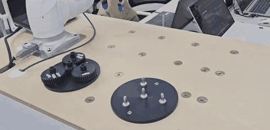
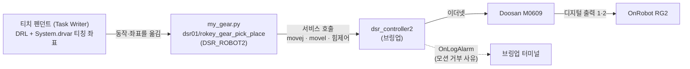

<div align="center">

# M0609 기어 조립: 티치 펜던트 DRL → ROS 2 Python

**티치 펜던트로 만든 두산 M0609 기어 조립 동작을 ROS 2 Python 노드로 옮기고, 그 과정에서 달라진 점을 고쳐 실제 로봇에서 끝까지 동작시켰습니다.**


<br>
<sub>▲ 실로봇 실행 (2배속) — 기어 3개를 옮긴 뒤 4번째 기어를 힘제어로 눌러 끼우고 팔을 들어 올림 · <a href="docs/images/gear_assembly_2x.mp4">MP4</a></sub>

</div>

<br>

## 🧭 개요

| 항목 | 내용 |
|---|---|
| 구분 | ROKEY 9기 협동-1 사전 실습 |
| 기간 | 2026-09-16 |
| 인원 · 담당 | 개인 · 담당: 티칭, DRL → ROS 2 Python 변환, 실로봇 디버깅 |
| 환경 | ROS 2 Jazzy · [doosan-robot2](https://github.com/DoosanRobotics/doosan-robot2) (`dsr_controller2`, `DSR_ROBOT2`) · Doosan M0609 + OnRobot RG2 |
| 상태 | ✅ 최종 코드로 기어 4개 전체 시퀀스와 홈 복귀까지 성공 1회 (9/16 18:36) — 재현 실행과 원본 값 재검증은 추후 과제 |

## 🎯 배경과 목표

수업에서 티치 펜던트(Task Writer)로 기어 4개를 옮기는 프로그램을 만들었습니다. 기어 3개는 집어서 옮기고, 4번째 기어는 순응·힘제어로 누르면서 Z축으로 흔들어 이를 맞춰 끼웁니다.

목표는 이 동작을 DRL로 내보낸 뒤 ROS 2 Python 노드로 옮겨, **실제 로봇에서 똑같이 끝까지 동작하게 만드는 것**이었습니다.

## 🏗 구성



| 단계 | 동작 |
|---|---|
| 시작 | 컨트롤러 서비스 대기 → 수동 모드에서 툴 `Tool Weight`·TCP `GripperDA_v1` 설정 → 자동 모드 (실패하면 로봇을 움직이지 않고 종료) |
| 기어 1~3 | 홈에서 출발해 기어마다 집기(50mm 하강 → 그리퍼 닫기 → 상승) → 놓기(50mm 하강 → 그리퍼 열기 → 상승) |
| 기어 4 | 집기 → 놓을 위치로 이동 후 30mm 하강 → 순응제어 + 힘제어(Z -5N, ABS)로 내려가며 \|Fz\| 3~8N이면 Z축 회전(±10도) 흔들기 → Z ≤ 80mm면 삽입 판정 |
| 마무리 | 그리퍼 열기 → 힘제어 해제 → 순응제어 해제 → 50mm 상승 → 홈 |

## 🙋 담당 역할

- 티치 펜던트(Task Writer)에서 기어 옮기기 동작과 티칭 좌표를 만들었습니다 → [`src/drl/`](src/drl/)
- DRL을 `DSR_ROBOT2` 기반 ROS 2 Python 노드로 옮겼습니다 → [`src/my_gear.py`](src/my_gear.py)
- 실제 로봇에서 노드를 19번 실행하며(9/16 오후, 노드 로그 기준) 증상을 확인하고, 노드 로그와 브링업 터미널 알람을 모아 문제를 하나씩 고쳤습니다.
- 펜던트에서 툴 무게와 TCP를 잡아 두고, 스크립트가 시작할 때 같은 이름으로 다시 적용하도록 했습니다.
- 변환·디버깅 중 겪은 문제 13개 항목과 원본/최종 비교를 [`docs/troubleshooting.md`](docs/troubleshooting.md)에 정리했습니다.

**고친 문제 요약** (증상·원인·근거 알람 전체는 [`docs/troubleshooting.md`](docs/troubleshooting.md)의 "한눈에 보기"와 항목별 설명)

| 구분 | 문제 | 고친 방법 |
|---|---|---|
| DRL ↔ ROS 2 | `mwait(time)`이 시간을 기다리지 않아 그리퍼가 닫히기 전에 팔이 올라감 | 그리퍼 대기는 `wait(2)` |
| DRL ↔ ROS 2 | 조건 함수가 참=0, 거짓=-1을 돌려줘 `if -1:`이 참 → 반복문이 바로 끝나고 원본 `release()` 하강으로 바닥 충돌 | `== 0` 비교, 힘은 `get_tool_force()`로 직접 판정, 삽입 후 그리퍼만 열기 |
| DRL ↔ ROS 2 | `set_tool`/`set_tcp`는 수동 모드에서만 받음, 툴/TCP가 빠진 채 실행된 경우도 있음 | 시작할 때 수동 → 설정 → 자동, 실패하면 종료 |
| DRL ↔ ROS 2 | 컨트롤러 서비스를 찾기 전에 보낸 첫 요청 유실 · 블렌딩 `radius=10` · 없는 인자(`app_type` 등) | `wait_for_service`, 집기·놓기 구간 `radius=0`, 인자 정리 |
| 실로봇 디버깅 | 힘제어 중 `amovel`을 함께 보내 흔들기 거부, 힘이 2N 안팎에서 멈춤 | `amovel`을 빼고 힘제어만으로 하강 |
| 실로봇 디버깅 | 테스트 값 `atime=0.5, repeat=1`이 규칙 위반 → 흔들기 즉시 반환 | `atime=0.3, repeat=2`, 2.5초 간격 |
| 실로봇 디버깅 | (추정) 목표 힘을 낮추자 `DR_FC_MOD_REL`의 영향이 드러남 | `DR_FC_MOD_ABS` |
| 실로봇 디버깅 | 편집 중 힘제어 해제 호출이 빠져 홈 복귀 거부 | 그리퍼 열기 → 힘제어 해제 → 순응제어 해제 → 상승 → 홈 |

## 📊 결과

- **9/16 18:36 실행(최종 코드)에서 기어 4개 전체 시퀀스와 홈 복귀까지 끝까지 동작했습니다.** 4번째 기어가 끝까지 끼워진 것을 현장에서 확인했습니다. 기어 1 이동 시작부터 작업 완료까지 약 44초 걸렸습니다.
- 삽입 구간 로그: 접촉 전 Fz 1.2N(툴 무게 보정 정상) → 힘제어를 켜고 약 1.4초 뒤 |Fz| 3.0N에서 흔들기 1회 → Z 85.6mm → 79.9mm로 내려가 약 3.9초 만에 삽입 판정. 같은 시간대 브링업 로그에 알람이 없었습니다.
- 바로 전 18:33 실행은 삽입까지 됐지만 힘제어 해제가 빠져 홈 복귀가 거부됐고, 해제 순서를 고친 뒤 18:36에 성공했습니다.
- 근거: [`docs/logs/`](docs/logs/)의 노드 로그 2개와 브링업 알람 발췌

## 💡 배운 점

- **이름이 같은 함수라도 DRL과 ROS 2 라이브러리는 다르게 동작할 수 있습니다.** `mwait`의 시간 인자, 조건 함수의 반환값(0/-1)이 그랬습니다. 펜던트에서 만든 코드를 옮길 때는 라이브러리 소스에서 함수 정의와 반환값을 먼저 확인해야 했습니다.
- **Python 함수가 0을 돌려줘도 컨트롤러가 그 모션을 받아들였다는 뜻은 아닙니다.** 거부 사유는 브링업 터미널 알람(`OnLogAlarm`)에만 나왔고, 18:33 실행은 홈 복귀가 거부됐는데도 노드는 "작업 완료"를 찍었습니다. 노드 로그만으로는 부족했고, 같은 시각의 브링업 알람을 함께 봐야 원인이 보였습니다.
- **힘제어 구간은 위치 이동 명령과 섞이면 상태가 꼬입니다.** 힘제어 중에는 위치 이동을 함께 보내지 않고, 끄는 순서(그리퍼 열기 → 힘제어 해제 → 순응제어 해제 → 이동)를 지켜야 했습니다.
- **디버깅하려고 바꾼 값이 새 문제를 만들 수 있습니다.** 테스트로 줄인 `atime`은 규칙 위반을 일으켰고, 줄인 목표 힘은 판정 경계에 걸린 것으로 보였습니다. 값을 하나 바꿀 때마다 로그로 확인해야 했습니다.
- 힘제어를 켜기 전에 접촉 전 힘과 위치를 로그로 찍어 두니, 툴 무게·TCP가 빠진 상태(Fz 약 -12N, Z 약 294mm)가 로그에 바로 드러났습니다. 그래서 시작할 때 설정 결과를 확인하고, 실패하면 로봇을 움직이지 않고 끝내도록 바꿨습니다.

## ⚠️ 한계와 추후 개선 과제

- 최종 코드로 끝까지 성공한 기록은 **1회(9/16 18:36, 약 44초)** 입니다. 이후 19:03 재실행은 로봇과의 네트워크 연결이 끊긴 상태(브링업 로그 18:54)라 진행되지 않았습니다. 재현 실행은 추후 과제입니다.
- 최종 값(목표 힘 -5N, 판정 3~8N, `atime 0.3 / repeat 2`)은 **디버깅 중 낮춘 값으로 성공한 것**입니다. 원본 DRL 값(-10N, 7~12N, `atime 1.0 / repeat 3`)으로 되돌린 재검증은 추후 과제입니다.
- 실행 영상(위 GIF)에는 촬영 시각 정보가 없어, 로그의 어느 실행인지 대조하는 것은 추후 과제입니다. 4번째 기어 삽입 뒤 홈 복귀까지 로그로 확인된 실행은 18:36 한 번입니다.
- 좌표는 그날 실습 셀에서 티칭한 관절 값이라, 다른 셀에서는 다시 티칭해야 합니다.

## 📂 폴더 구조

```text
m0609-gear-drl-to-ros2/
├── README.md
├── src/
│   ├── my_gear.py                    # ROS 2 Python 노드 (18:36 성공 버전)
│   └── drl/
│       ├── m0609_homework_gear_1.drl # 티치 펜던트(Task Writer)에서 만든 원본 DRL
│       └── System.drvar              # 티칭 좌표 (기어 4개 집기/놓기 관절 값)
└── docs/
    ├── troubleshooting.md            # 문제 13개 항목, 원본/최종 비교, 실행 기록
    ├── images/
    │   ├── gear_assembly_2x.gif      # 실로봇 실행 영상 2배속 (주변 인물 제외하고 자름, 소리 없음)
    │   └── gear_assembly_2x.mp4      # 같은 영상 MP4
    └── logs/
        ├── run_20260916_1833_insert_ok_home_rejected.log   # 삽입 성공, 홈 복귀 거부
        ├── run_20260916_1836_full_success.log              # 최종 코드 전체 성공
        └── bringup_alarms_excerpt.txt                      # 브링업 알람 발췌 (KST, 환경 정보 제외)
```

## 🚀 실행 방법

이 폴더에는 노드 파일만 있습니다. ROS 2 패키지 파일(`package.xml`, `setup.py`)과 두산 공식 패키지는 넣지 않았습니다.

**전제**: ROS 2 Jazzy, [doosan-robot2](https://github.com/DoosanRobotics/doosan-robot2), M0609 + RG2 브링업이 되는 워크스페이스. 펜던트에 툴 `Tool Weight`, TCP `GripperDA_v1`이 등록되어 있어야 합니다(이름이 다르면 `my_gear.py`의 `TOOL_NAME`, `TCP_NAME` 수정).

1. `src/my_gear.py`를 워크스페이스의 ament_python 패키지 모듈 폴더에 넣습니다.
2. 그 패키지 `setup.py`의 `console_scripts`에 entry point를 등록합니다.
   ```python
   'my_gear = <패키지명>.my_gear:main',
   ```
3. 빌드하고 실행합니다. 브링업은 실행 내내 켜 두어야 합니다.
   ```bash
   colcon build --symlink-install --packages-select <패키지명>
   source install/setup.bash
   ros2 run <패키지명> my_gear
   ```

> 실제 로봇이 원본 DRL 속도(관절 150°/s)로 움직입니다. 처음에는 `J_VEL`, `L_VEL` 값을 낮추고 비상정지 버튼을 손에 둔 채 실행하세요.

## 📜 출처와 라이선스

- 코드는 저장소 루트 [LICENSE](../LICENSE)(Apache-2.0)를 따릅니다.
- 노드 실행 뼈대(`DR_init` 설정, `DSR_ROBOT2` import, 예외 처리)는 수업 제공 템플릿 패턴을 따랐습니다.
- `DSR_ROBOT2`·`dsr_controller2`는 [doosan-robot2](https://github.com/DoosanRobotics/doosan-robot2)에 들어 있으며 이 폴더에는 포함하지 않았습니다.
