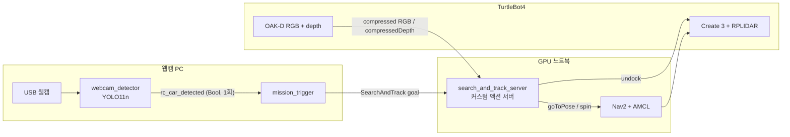

# TurtleBot4 RC카 탐색·추적 (ROKEY 지능1 팀 미니프로젝트)

고정 웹캠이 TurtleBot4의 사각지대에서 RC카를 발견하면, 로봇이 스스로 출발해 그 구역을 회전 탐색하고 RC카에 다가가 따라가게 하려던 ROS 2 팀 미니프로젝트입니다.

> **상태: 미완성.** 통합 테스트에서 탐색 위치까지 이동은 했지만, 회전 탐색 중 RC카를 목표로 고정(lock)하지 못했습니다.
> 원인을 가리려고 탐색 방식만 바꾼 v1~v4를 만들었지만, 로봇에서 검증하지 못하고 끝났습니다.

| 항목 | 내용 |
|---|---|
| 기간 | 2026년 8월 말 ~ 9월 초, 약 1주 |
| 팀 | 4명 |
| 내 역할 | 객체 탐지 (웹캠으로 RC카·더미 박스를 인식하는 파트, 인식 모델 포함) |
| 환경 | ROS 2 Jazzy, TurtleBot4 (OAK-D, RPLIDAR), Nav2, USB 웹캠, Ultralytics YOLO11n + ByteTrack |

## 배경과 목표

강의 과제(Team Exercise)는 "이벤트를 받으면 AMR이 언도킹하고, 장애물을 피하며 더미는 무시하고, 목표를 추적·접근한다"였습니다. 우리 팀은 이를 아래 시나리오로 구체화했습니다.

1. 고정 웹캠이 도킹된 로봇이 볼 수 없는 구역을 감시합니다.
2. 웹캠이 RC카를 인식하면 트리거 토픽을 한 번 보냅니다.
3. 로봇이 언도킹 → 웹캠 감시 구역(`search_pose`)으로 이동 → 제자리 360° 회전 탐색 → RC카 추적 ID 고정 → 0.3 m 거리를 유지하며 접근·추종합니다.
4. 더미 박스는 클래스로 거르고, 다른 RC카는 처음 고정한 추적 ID로 구분하는 것이 설계 의도였습니다(시험하지 못함).



액션 서버 상태: `UNDOCKING → NAV_TO_SEARCH → SEARCHING(360° 회전 + lock) → APPROACHING / FOLLOWING ↔ HOLDING` (목표를 놓치면 `SEARCHING`으로 돌아감).
통합 테스트는 `SEARCHING`에서 멈췄습니다.

## 역할 분담

| 담당 | 역할 |
|---|---|
| 팀원 A (기술 리드) | 시스템 통합, 미션 관리 |
| 팀원 B | 내비게이션, 회피 |
| 팀원 C | 브링업, SLAM |
| 나 | 객체 탐지: 웹캠 RC카·더미 박스 인식(데이터 수집·라벨링·모델 선정·학습·평가) |

## 내가 한 것

1. **RC카·더미 박스 인식 모델** — 팀과 함께 RC카와 더미 박스를 촬영·라벨링하고, 웹캠용으로 YOLO11n을 선정해 파인튜닝했습니다. → [`models/`](02_search_and_track/rc_tracker/models/)
2. **인식 프로토타입 노드 (09-01)** — 로봇 카메라 영상에 YOLO + ByteTrack을 붙여 RC카·더미 박스에 추적 ID를 다는 노드를 만들고, 로봇을 세운 상태에서 동작을 확인했습니다. → [`01_perception_prototype/`](01_perception_prototype/)
3. **웹캠 감지·트리거 노드** — 웹캠 YOLO가 `RC`를 N프레임 연속으로 잡으면 latched `Bool`을 한 번 보내고, 이를 받아 액션 goal을 보내는 노드입니다(`webcam_detector`, `mission_trigger`).
4. **통합 테스트와 현장 디버깅** — 09-03 통합 테스트에서 미션 서버(`search_and_track_server`)를 실제 로봇에 올려 보며 찾은 문제를 반영했습니다.
   - 도킹 중에는 RPLIDAR가 멈춰 `/scan`이 없고, 그래서 AMCL이 위치를 잡지 못했습니다. → **언도킹 → 초기 위치 설정 → Nav2 대기** 순서로 바꿨습니다.
   - 좁은 구역에서 경로 계산이 실패했습니다. → costmap `inflation_radius`를 0.45에서 0.25로 줄였습니다.
   - 언도킹 위치(x, y)를 `initial_pose`로, RViz로 찍은 웹캠 감시 구역 중심을 `search_pose`로 넣었습니다(yaw는 추정치).
5. **실패 원인을 가르기 위한 탐색 변형 v1~v4** — 회전 속도, depth 토픽 지연, 모션 블러라는 가설 3개를 하나씩 가를 수 있도록 탐색 방식만 바꾼 변형 4개와 판별용 `[SEARCH]` 로그를 만들었습니다. → [`search_variants/`](02_search_and_track/search_variants/)

**팀원 기여**: 미션 서버의 RGB-depth 시간 동기화(`ApproximateTimeSynchronizer`), `compressedDepth` 직접 디코드, 목표 앞 정지 위치(stand-off goal) 계산은 팀원이 추가했습니다. 로봇 TF 프레임 확인과 SLAM 가이드도 팀원 작업입니다.

## 결과

| 단계 | 결과 | 근거 |
|---|---|---|
| 인식 단독 (로봇 정지) | `RC`·`dummy` 구분 검출, 추적 ID 대체로 유지. 가림 시 RC를 놓치거나 ID가 바뀜 | 아래 GIF (09-01) |
| 웹캠 인식 → 트리거 → 액션 goal → 탐색 위치 이동 | 동작 | 당시 작업 기록 (09-03) |
| 탐색 위치에서 360° 회전 중 lock | **실패** (탐지는 되지만 고정 판정이 걸리지 않음) | 당시 작업 기록 (09-03) |
| 접근·추종, 다른 RC카(디코이) 구분 | 테스트하지 못함 | — |
| 탐색 변형 v1~v4 | 로봇 미검증 | — |

통합 테스트의 근거는 당시 정리한 작업 기록이며, 영상·rosbag·서버 로그는 남아 있지 않습니다.


*인식 단계 단독 테스트(09-01). 로봇을 세워 두고 OAK-D 영상에 커스텀 YOLO + ByteTrack을 적용한 화면입니다. 미션(탐색·추종) 실행 영상이 아닙니다.*

## 배운 점

- 실제 로봇에서는 인식 알고리즘보다 기동 순서와 파라미터가 먼저 막혔습니다. 도킹 중에는 라이다가 멈춰 위치 추정이 안 됐고, 좁은 구역에서는 costmap 팽창 반경 때문에 경로가 나오지 않았습니다.
- 로봇을 세워 두고 통과한 인식도, 로봇이 회전하는 동안에는 회전 속도·이미지 지연·블러 같은 다른 조건에 놓입니다. 정지 상태 테스트만으로는 움직이는 로봇의 인식을 보장할 수 없었습니다.
- 실패 직후 바로 고치기보다 가설을 나누고, 가설마다 결과가 갈리도록 변형과 로그를 먼저 설계했습니다. 다만 로봇 시험 시간을 확보하지 못해 검증까지 가지 못했습니다.

## 한계

- lock 실패의 원인은 확정하지 못했고, v1~v4와 접근·추종 단계는 로봇에서 시험하지 않았습니다.
- `relock_on_reacquire: true`라서 목표를 놓친 뒤 재탐색하면 다른 RC카를 고정할 수 있습니다. 더미는 추적 ID가 아니라 클래스 필터로 걸러집니다.
- v1~v4의 수동 회전(`cmd_vel`) 중 예외가 나면 정지 명령을 보내는 처리가 없습니다.
- `search_pose`, `initial_pose`는 교육장 지도 기준 좌표이고 `initial_pose`의 yaw는 추정치입니다. 맵 파일은 저장소에 없습니다.
- 그 밖에 발견했지만 고치지 않은 것: [`docs/search_variants.md`](docs/search_variants.md) 6절

## 폴더 구조

```text
tb4-rc-car-search-track/
├── 01_perception_prototype/        # 09-01 인식 프로토타입
│   ├── tb4_yolo_tracker/           #   YOLO + ByteTrack 추적 노드 (ROS 2 패키지)
│   └── perception_demo.gif         #   인식 단독 테스트 화면
├── 02_search_and_track/
│   ├── rc_tracker_interfaces/      # SearchAndTrack.action
│   ├── rc_tracker/                 # 미션 패키지 기준판(v0): 노드 3개, launch 3개, config, 모델
│   └── search_variants/            # v1~v4 — 기준판과 다른 파일만
└── docs/
    ├── run.md                      # 실행 순서와 문제 해결
    ├── search_variants.md          # v1~v4 변경 내역과 시험 방법
    ├── design_initial_0902.md      # 초기 인터페이스 설계 (최종 구현과 다른 점 표시)
    └── flowchart_initial_0902.drawio
```

## 실행 방법

맵은 저장소에 없습니다. 직접 만든 맵을 준비하고 `search_pose`, `initial_pose`를 그 맵 좌표로 바꿔야 합니다. 자세한 절차는 [`docs/run.md`](docs/run.md)에 있습니다.

```bash
# 빌드 (두 PC 모두)
pip install ultralytics opencv-python numpy
# 02_search_and_track/의 rc_tracker_interfaces, rc_tracker를 워크스페이스 src/에 넣고
colcon build --symlink-install && source install/setup.bash

# ① 로봇 언도킹 (도킹 중에는 라이다가 멈춰 AMCL이 동작하지 않음)
ros2 action send_goal /robot2/undock irobot_create_msgs/action/Undock "{}"
# ② Nav2 + localization (GPU 노트북)
ros2 launch rc_tracker nav.launch.py namespace:=/robot2 map:=/path/to/your_map.yaml
# ③ 액션 서버 (GPU 노트북)
ros2 launch rc_tracker server.launch.py namespace:=/robot2
# ④ 웹캠 감지 + 트리거 (웹캠 PC)
ros2 launch rc_tracker station.launch.py
```

## 출처와 라이선스

- `rc_tracker/config/nav2.yaml`: [turtlebot4_navigation](https://github.com/turtlebot/turtlebot4) 기본 설정(Apache-2.0)에서 `inflation_radius`만 바꿨습니다. 파일 상단에 출처를 적었습니다.
- 인식 모델 `rc_dummy_y11n.pt`: Ultralytics YOLO11n 파생 모델이라 AGPL-3.0을 따릅니다. 노드들도 Ultralytics 라이브러리(AGPL-3.0)를 사용합니다.
- depth → 3D → map 변환과 언도킹·초기 위치 설정 흐름은 강의 예제의 패턴을 참고했습니다. 강의 자료, 공식 패키지 코드, 팀원 개인 패키지는 넣지 않았습니다.
