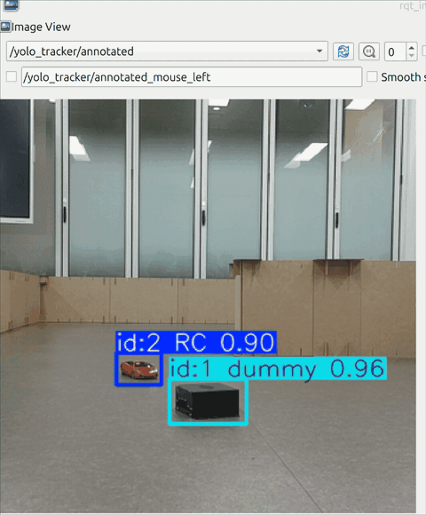

# 인식 프로토타입 (2026-09-01)

미션 코드를 만들기 전에, 로봇 카메라 영상에서 RC카와 더미 박스를 검출하고 추적 ID가 유지되는지 먼저 확인하려고 만든 ROS 2 노드다.



로봇을 세워 둔 상태에서 OAK-D RGB preview 영상에 커스텀 YOLO(클래스 `RC`, `dummy`)와 ByteTrack을 적용하고, 결과 토픽 `/yolo_tracker/annotated`를 rqt_image_view로 본 화면이다.
**미션(탐색·접근·추종) 실행 영상이 아니다.** RC카가 더미 박스에 가려지는 구간에서는 RC 박스가 사라지거나 추적 ID가 2에서 8로 바뀌는 장면이 있다.
(원본 녹화에서 앞부분 약 3초의 어두운 오버레이를 잘라내고 폭을 480px로 줄였다.)

## 노드 동작 — [`src/tb4_yolo_tracker/tb4_yolo_tracker/yolo_tracker_node.py`](../src/tb4_yolo_tracker/tb4_yolo_tracker/yolo_tracker_node.py)

- 카메라 이미지(`raw` 또는 `compressed`)를 구독하되 **가장 최근 프레임 1장만** 보관한다. 타이머(`inference_rate`)마다 그 프레임만 추론하므로, 추론이 카메라보다 느려도 지연이 쌓이지 않는다.
- `model.track(persist=True, tracker='bytetrack.yaml')`로 프레임 사이에 추적 ID를 유지한다.
- 결과는 두 가지로 발행한다.
  - `~/detections` (`vision_msgs/Detection2DArray`): bbox, 클래스명, score, 추적 ID
  - `~/annotated` (`sensor_msgs/Image`): 박스와 ID를 그린 이미지
- 주요 파라미터: `model_path`, `image_topic`, `image_transport`, `conf`, `iou`, `tracker`, `device`, `imgsz`, `classes`, `inference_rate`

## 실행

```bash
pip install ultralytics
# 이 프로젝트의 src/tb4_yolo_tracker 폴더를 워크스페이스 src/에 넣고
colcon build --packages-select tb4_yolo_tracker && source install/setup.bash

ros2 run tb4_yolo_tracker yolo_tracker --ros-args \
  -p image_topic:=/robot2/oakd/rgb/preview/image_raw \
  -p model_path:=<repo>/tb4-rc-car-search-track/src/rc_tracker/models/rc_dummy_y11n.pt \
  -p device:=cpu -p imgsz:=640 -p conf:=0.25 -p inference_rate:=8.0

ros2 run rqt_image_view rqt_image_view /yolo_tracker/annotated
```

파라미터는 당시 실행 명령과 같고, 모델 경로만 이 저장소 기준으로 바꿨다.
[`launch/yolo_tracker.launch.py`](../src/tb4_yolo_tracker/launch/yolo_tracker.launch.py)는 기본값(COCO `yolov8n.pt`, 네임스페이스 없는 preview 토픽)으로 띄우는 launch다.

원래는 수업 실습용 패키지 안에 만들었던 노드다. 이 저장소에서는 이 노드와 launch만 단독 패키지 `tb4_yolo_tracker`로 분리했고, 노드 코드는 바꾸지 않았다.

## 여기서 확인한 것과 다음 단계로 이어진 점

- 로봇이 멈춘 상태에서는 `RC`와 `dummy`가 구분돼 검출되고, 추적 ID도 대체로 유지됐다.
- 가림이 생기면 RC를 놓치거나 ID가 바뀌었다.
- 같은 방식(YOLO + ByteTrack 추적 ID)을 미션 서버([`src/rc_tracker`](../src/rc_tracker/))의 목표 고정(lock)에 썼다.
- 로봇이 **회전하는 동안**의 인식은 이 단계에서 시험하지 않았다. 이후 통합 테스트에서 실패한 곳이 바로 회전 탐색 단계였다.
